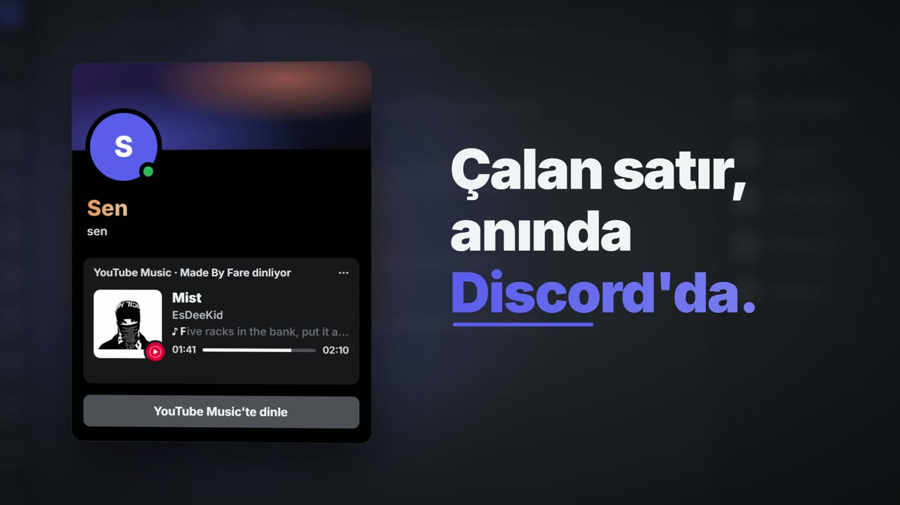

<p align="center">
  
</p>

<h1 align="center">Lyricord</h1>

<p align="center">
  Shows the song you're playing, and the line being sung, on your Discord profile.<br>
  Works with YouTube Music, SoundCloud, Spotify and Apple Music. Free.
</p>

<p align="center"><a href="README.md">Türkçe</a></p>

<p align="center">
  <a href="media/lyricord-tanitim.mp4"></a><br>
  <a href="media/lyricord-tanitim.mp4">▶ Watch the intro video (1.5 min, Turkish)</a>
</p>

## Setup (Windows, 5 minutes)

You need: [Node.js](https://nodejs.org), the Discord desktop app and Chrome.

**1. Get an ID from Discord**
On the [Discord Developer Portal](https://discord.com/developers/applications) click **New Application**, give it a name (e.g. `Lyricord`) and copy the **Application ID**.

**2. Download and install Lyricord**
On this page click **Code → Download ZIP** and extract it. Open PowerShell in the folder and paste:

```powershell
powershell -ExecutionPolicy Bypass -File .\install.ps1
```

Paste the Application ID when asked. The rest installs itself.

**3. Add the extension to Chrome**
Open `chrome://extensions`, turn on **Developer mode** (top right), click **Load unpacked** and pick the `extension` folder.

Done. Play a song and look at your Discord profile.

## Settings

Click the Lyricord icon in Chrome. Turn the cover, site logo, lyrics, progress bar and "listen" button on or off. The preview at the top shows how your profile will look.

## Something wrong?

| Problem | Fix |
| --- | --- |
| The panel says **Helper off** | Double-click `helper\start-hidden.vbs` in the folder. |
| The panel says **Discord closed** | Open the Discord desktop app (Discord in the browser won't work). |
| Nothing shows on my profile | In Discord, turn on **Settings → Activity Privacy → Share my activity**. |
| No lyrics | The sources don't have lyrics for that song. |

Still stuck? Message me with the buttons on the panel's **General** tab.

## Uninstall

Open PowerShell in the folder and run this, then remove the extension on `chrome://extensions`:

```powershell
powershell -ExecutionPolicy Bypass -File .\uninstall.ps1
```

## Privacy

Song info only goes to your own computer and Discord. To find lyrics, only the title, artist and length are sent to the public lyric sites [LRCLIB](https://lrclib.net) and [lyrics.ovh](https://lyricsovh.docs.apiary.io).

## License

[MIT](LICENSE). YouTube Music, SoundCloud, Spotify, Apple Music and Discord are trademarks of their owners; Lyricord is not affiliated with them.

Intro video: voice-over made with [ElevenLabs](https://elevenlabs.io), background music by jonasblakewood (Pixabay).
