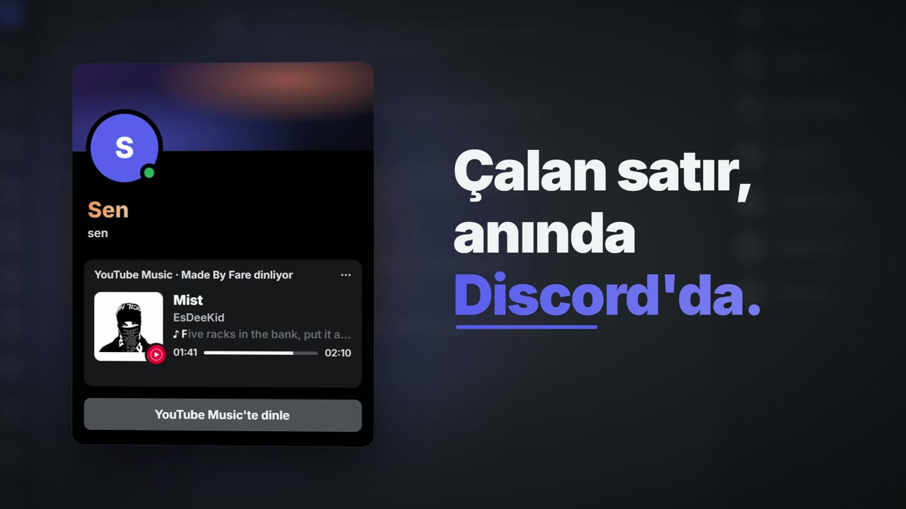

<p align="center">
  
</p>

<h1 align="center">Lyricord</h1>

<p align="center">
  Dinlediğin şarkıyı ve o an söylenen sözü Discord profilinde gösterir.<br>
  YouTube Music, SoundCloud, Spotify ve Apple Music ile çalışır. Ücretsiz.
</p>

<p align="center"><a href="README.en.md">English</a></p>

<p align="center">
  <a href="media/lyricord-tanitim.mp4"></a><br>
  <a href="media/lyricord-tanitim.mp4">▶ Tanıtım videosunu izle (1,5 dk)</a>
</p>

## Kurulum (Windows, 5 dakika)

Bilgisayarında şunlar olmalı: [Node.js](https://nodejs.org), Discord masaüstü uygulaması ve Chrome.

**1. Discord'dan bir kimlik al**
[Discord Developer Portal](https://discord.com/developers/applications)'da **New Application**'a bas, bir ad ver (ör. `Lyricord`) ve **Application ID**'yi kopyala.

**2. Lyricord'u indir ve kur**
Bu sayfada **Code → Download ZIP**'e bas ve klasöre çıkar. Klasörün içinde PowerShell aç ve şunu yapıştır:

```powershell
powershell -ExecutionPolicy Bypass -File .\install.ps1
```

Application ID'yi sorduğunda yapıştır. Gerisi kendiliğinden kurulur.

**3. Eklentiyi Chrome'a ekle**
Chrome'da `chrome://extensions` adresini aç, sağ üstten **Geliştirici modu**nu aç, **Paketlenmemiş öğe yükle**'ye bas ve `extension` klasörünü seç.

Bitti. Bir şarkı çal ve Discord profiline bak.

## Ayarlar

Chrome'da Lyricord ikonuna tıkla. Kapak, site logosu, sözler, süre çubuğu ve "dinle" butonunu açıp kapatabilirsin. Üstteki önizleme, profilinde nasıl görüneceğini gösterir.

## Bir sorun mu var?

| Sorun | Çözüm |
| --- | --- |
| Panelde **Program kapalı** yazıyor | Klasördeki `helper\start-hidden.vbs` dosyasını çift tıkla. |
| Panelde **Discord kapalı** yazıyor | Discord masaüstü uygulamasını aç (tarayıcıdaki Discord çalışmaz). |
| Profilimde hiçbir şey görünmüyor | Discord'da **Ayarlar → Etkinlik Gizliliği → Etkinliğimi paylaş**'ı aç. |
| Şarkı sözü çıkmıyor | O şarkının sözü kaynaklarda yok demektir. |

Hâlâ çözemediysen panelin **Genel** sekmesindeki butonlardan bana yaz.

## Kaldırma

Klasörde PowerShell aç ve şunu çalıştır, sonra eklentiyi `chrome://extensions` sayfasından kaldır:

```powershell
powershell -ExecutionPolicy Bypass -File .\uninstall.ps1
```

## Gizlilik

Şarkı bilgisi sadece kendi bilgisayarına ve Discord'a gider. Sözleri bulmak için yalnızca şarkı adı, sanatçı ve süre, herkese açık söz siteleri [LRCLIB](https://lrclib.net) ve [lyrics.ovh](https://lyricsovh.docs.apiary.io)'a sorulur.

## Lisans

[MIT](LICENSE). YouTube Music, SoundCloud, Spotify, Apple Music ve Discord kendi sahiplerinin markalarıdır; Lyricord onlarla bağlantılı değildir.

Tanıtım videosu: seslendirme [ElevenLabs](https://elevenlabs.io) ile yapıldı, arka plan müziği jonasblakewood (Pixabay).
